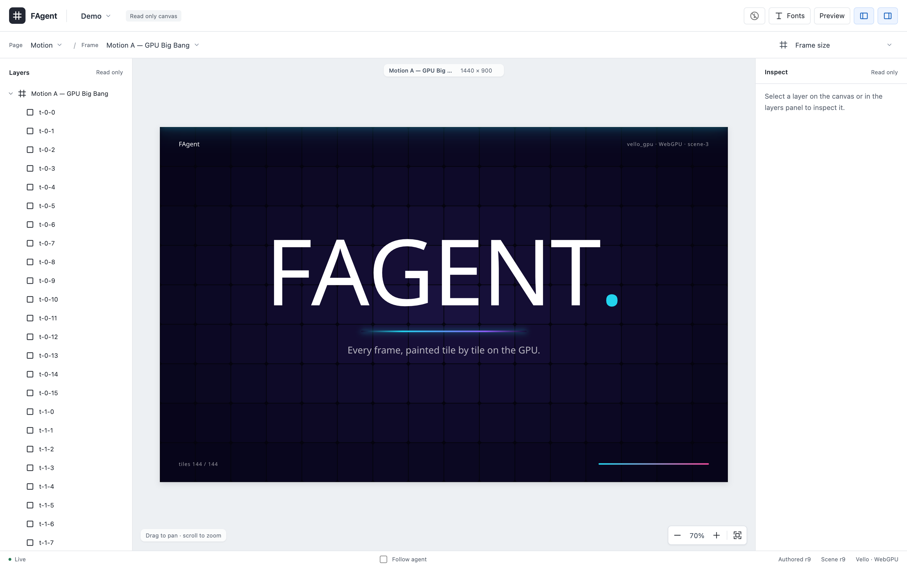
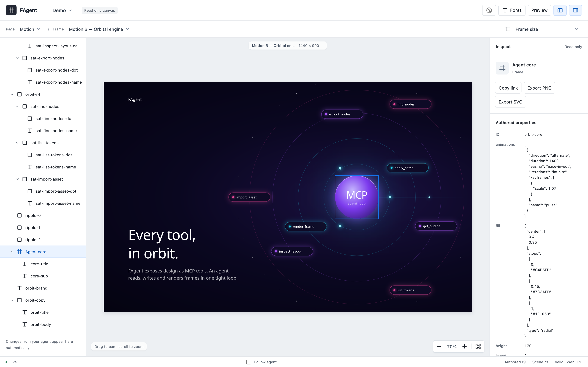
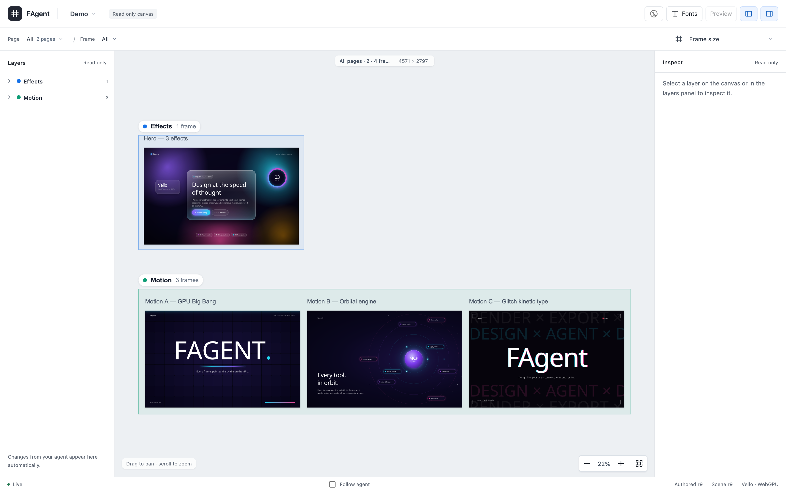
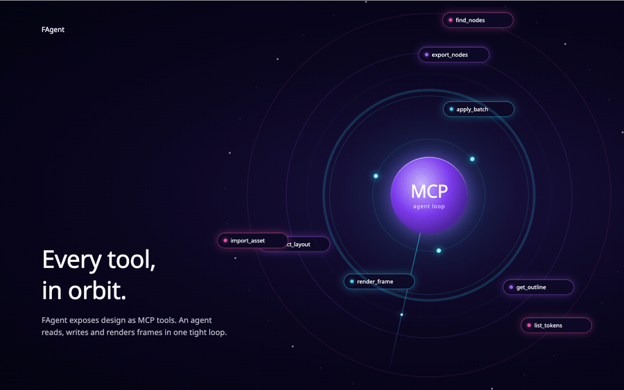

<p align="center">
  
</p>

<h1 align="center">FAgent</h1>

<p align="center">
  <b>Not another design tool rebuilt for humans — a design tool built for agents.</b>
</p>

<p align="center">
  <a href="#quick-start">Quick start</a> ·
  <a href="#connect-an-agent">Connect an agent</a> ·
  <a href="docs/GETTING-STARTED.md">Guide</a> ·
  <a href="docs/SERVER.md">MCP reference</a> ·
  <a href="docs/ARCHITECTURE.md">Architecture</a> ·
  <a href="docs/PERFORMANCE.md">Benchmarks</a>
</p>

<p align="center">
  
  
  
  
</p>

FAgent gives AI agents a real design surface. Agents create, read and edit designs through
[MCP](https://modelcontextprotocol.io); you watch the result live in a read-only browser viewer,
inspect any node, play its motion and share it. There is no mouse editor, chat or terminal inside
the product: **the agent is the author, and the viewer is where you review its work.**

Every frame on this page was authored by an agent through FAgent's own MCP tools.

## How it works

1. **The agent writes.** About twenty MCP tools read, write, render and export. Writes are atomic,
   idempotent batches — JSON operations or the compact OCD line DSL — guarded by the revision they
   were based on.
2. **The server owns the design.** A Rust backend keeps pages, frames and stacks, tokens with
   themes, styles, components and instances, states, links and animations. Every read is one
   consistent revision, stored in SQLite (default) or PostgreSQL.
3. **You watch it live.** A GPU viewer powered by [Vello](https://github.com/linebender/vello)
   shows each commit as it lands, with deep links to any element, a motion preview and PNG/SVG
   exports.

## See it in action

<table>
  <tr>
    <td width="50%"></td>
    <td width="50%"></td>
  </tr>
  <tr>
    <td><b>Live viewer.</b> Frames render on the GPU and update as the agent commits.</td>
    <td><b>Inspect anything.</b> Authored props sit next to the tokens and styles behind them.</td>
  </tr>
  <tr>
    <td></td>
    <td></td>
  </tr>
  <tr>
    <td><b>All pages board.</b> Every root frame of every page on one canvas.</td>
    <td><b>Motion preview.</b> Declared animations, states and links play in the browser.</td>
  </tr>
</table>

## Highlights

- **MCP-first authoring** — `apply_batch` takes up to 500 ordered operations or OCD source, with
  `expectedRevision`, an `idempotencyKey`, page-scoped guards and `dryRun`.
  [Tools →](docs/SERVER.md)
- **Token-efficient by design** — depth-limited outlines, `find_nodes`, compact scoped context,
  inbox file imports instead of base64, and renders that omit the scene unless asked.
- **Design-system building blocks** — color, dimension and number tokens with aliases and
  themes, styles, components with flat instance overrides, interaction states, prototype links
  and animations. [Tokens →](docs/RESOLUTION.md) · [Components →](docs/COMPONENTS.md)
- **Built to be implemented** — `get_design_context` returns authored references beside resolved
  values, so code is written against tokens, not raw colors.
- **GPU viewer** — one WASM engine in a Worker computes scenes with the server's Rust core and
  paints with Vello: WebGPU, then WebGL2, `vello_cpu`, Canvas2D. [Viewer →](docs/VIEWER.md)
- **Live, linkable, shareable** — Server-Sent Events updates, **Follow agent**, deep links to any
  node, and an opt-in read-only public viewer (optional password) for projects marked `public`.
- **Exports and fonts** — PNG/SVG from the Inspector or `export_nodes` (SVG embeds the exact
  font bytes); TTF/OTF/WOFF2 fonts live in the project, never in the OS.
  [Fonts →](docs/FONTS.md)
- **Self-contained backups** — export, import and restore project bundles with a checksummed
  manifest. [Backups →](docs/BACKUP.md)

## Quick start

**Docker** — no local toolchain; the image bundles the server, viewer and renderer:

```sh
docker build -t fagent:local .
docker compose up -d
```

**From source** — Rust 1.99, Node 24 and npm 11:

```sh
npm ci && npm --prefix web ci
export PLAYWRIGHT_BROWSERS_PATH="$PWD/.runtime/browsers" && npx playwright install chromium
npm run build:engine-wasm   # Vello viewer engine (needs wasm32-unknown-unknown + wasm-bindgen)
npm run build:release
npm start
```

Open the viewer at <http://127.0.0.1:3847>. Starting the server creates no demo project; your
agent creates the first one. Build profiles, storage, Docker volumes, PostgreSQL and Kubernetes
are covered in the [getting started guide](docs/GETTING-STARTED.md).

## Connect an agent

Point any MCP client at the **Streamable HTTP** endpoint (an HTTP URL, not a stdio command):

```json
{ "url": "http://127.0.0.1:3847/mcp" }
```

Then ask your agent to design something. A typical session calls `create_project`, writes a page
and frames with `apply_batch`, checks itself with `render_frame`, and reads frames back with
`get_design_context` when it is time to implement them. A batch in OCD source looks like this:

```text
@token ink #111827
@style h1 font=font_bundled size=24/32 fill=$ink

page#login
  frame#screen 1280x800 fill=#F3F4F6 col align=center justify=center
    frame#card w=400 h=hug fill=#FFFFFF r=16 col p=32 gap=16
      text .h1 "Sign in"
```

Agents can read the authoring guides as MCP resources (`skill://fagent/author-frame.md`,
`skill://fagent/ocd.md`, `skill://fagent/props.md`). The full workflow is in
[Connect an agent](docs/GETTING-STARTED.md#connect-an-agent).

## Performance at a glance

With **node-memory**, hot projects stay in RAM with indexes updated per operation, while the
database remains the source of truth. On a 200k-node project (PostgreSQL, release build):

| Measurement | Database-only path (former) | Node-memory (always on) |
| --- | --- | --- |
| `get_design_context`, one frame | 156 ms cached; 207 ms right after a write | **1.5 ms** warm; **2.0 ms** right after a write |
| Commit of a props edit on a master child (929 instances), median of 30 | 988 ms | **21 ms** |
| Commit of a props edit on a plain node, median of 30 | – | **2.9 ms** (validation 0.01 ms) |
| First access to a cold project (load + full validation once) | – | **1.1 s** |
| RAM per authored node | – | **~1.25 KB** |

Since [Task41](tasks/41-node-memory-engine.md) phase 3 a commit validates only the batch's delta and the nodes that
depend on it; the whole project is validated once, when it is loaded. Medians on a generated fixture under moderate
machine load, recorded in the repository; read them as orders of magnitude. Method and the backend and viewer
benchmarks: [Performance](docs/PERFORMANCE.md).

## Documentation

| Topic | Document |
| --- | --- |
| Build, run, connect, storage, Docker, public viewer, tests | [docs/GETTING-STARTED.md](docs/GETTING-STARTED.md) |
| Architecture, crates, render and export backends | [docs/ARCHITECTURE.md](docs/ARCHITECTURE.md) |
| Benchmarks and node-memory | [docs/PERFORMANCE.md](docs/PERFORMANCE.md) |
| MCP tools, HTTP API, jobs, SSE, public viewer | [docs/SERVER.md](docs/SERVER.md) |
| Viewer ↔ HTTP API contract and data types | [docs/CONTRACT.md](docs/CONTRACT.md) |
| Browser viewer, Vello engine, All pages, motion preview | [docs/VIEWER.md](docs/VIEWER.md) |
| Tokens, aliases and themes | [docs/RESOLUTION.md](docs/RESOLUTION.md) |
| Components and instances | [docs/COMPONENTS.md](docs/COMPONENTS.md) |
| Fonts | [docs/FONTS.md](docs/FONTS.md) |
| Project bundles, backup and restore | [docs/BACKUP.md](docs/BACKUP.md) |
| Native macOS runtime and PostgreSQL backups | [docs/NATIVE-RUNTIME.md](docs/NATIVE-RUNTIME.md), [docs/NATIVE-BACKUP.md](docs/NATIVE-BACKUP.md) |
| Product requirements and acceptance criteria | [PLAN.md](PLAN.md), [docs/ACCEPTANCE.md](docs/ACCEPTANCE.md) |

## Contributing

Read [PLAN.md](PLAN.md) for the product requirements and [AGENTS.md](AGENTS.md) for the working
rules. Enable the public-content hook with `git config core.hooksPath .githooks` and install
[gitleaks](https://github.com/gitleaks/gitleaks) so commits are scanned for private data and
secrets. Tests and the live E2E run are described under
[Verification](docs/GETTING-STARTED.md#verification).

## License

Licensed under either of [Apache License, Version 2.0](LICENSE-APACHE) or [MIT license](LICENSE-MIT)
at your option.

Unless you explicitly state otherwise, any contribution intentionally submitted for inclusion in
the work by you, as defined in the Apache-2.0 license, shall be dual licensed as above, without
any additional terms or conditions.

Bundled fonts keep their own licenses: Noto Sans ([renderer/fonts/OFL.txt](renderer/fonts/OFL.txt))
and the Lato test fixtures ([fixtures/fonts/Lato-OFL.txt](fixtures/fonts/Lato-OFL.txt)) are under
the SIL Open Font License 1.1.
